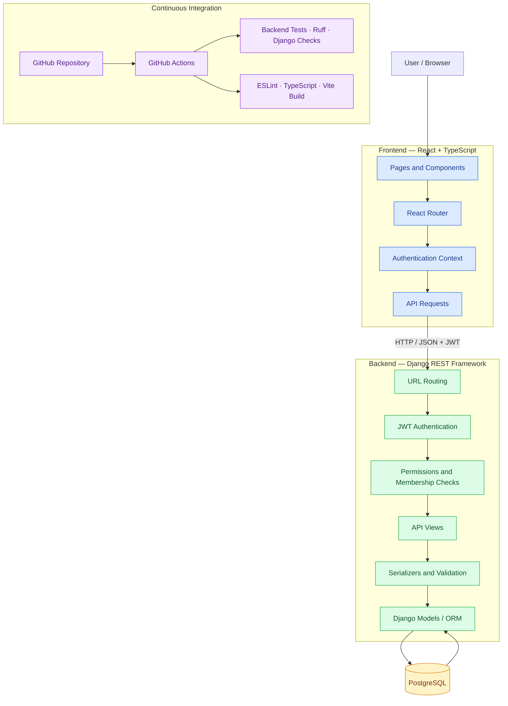

# TaskFlow API

A full-stack project and task management application built with Django REST Framework, React, TypeScript, and PostgreSQL.

TaskFlow provides organization-based collaboration, project management, task assignment, comments, and activity tracking through a documented REST API and a responsive web interface.

## Features

- **Authentication:** User registration and JWT authentication.
- **Organizations:** Create organizations and manage memberships and roles.
- **Invitations:** Invite users to organizations, accept invitations, and cancel pending invitations.
- **Projects:** Organize work into projects within organizations.
- **Tasks:** Create, update, assign, filter, search, and order tasks.
- **Comments:** Collaborate through task comments.
- **Activity history:** Track task events such as creation, assignment, and comments.
- **API documentation:** OpenAPI schema and interactive Swagger UI.
- **Automated quality checks:** Backend tests, frontend linting, builds, and GitHub Actions CI.

## Technology Stack

## Architecture

### System overview



### Request and authentication flow

1. The user interacts with the React interface.
2. The frontend sends HTTP requests to the Django REST API.
3. JWT authentication identifies the user when an endpoint requires authentication.
4. Permission checks enforce access rules, including organization membership and roles.
5. Serializers validate incoming data and format API responses.
6. Django's ORM reads or writes application data in PostgreSQL.
7. The API returns a JSON response to the frontend.

### Backend

- Python
- Django
- Django REST Framework
- PostgreSQL
- JWT authentication
- drf-spectacular

### Frontend

- React
- TypeScript
- Vite
- React Router

### Development and quality

- Docker Compose
- pytest
- Ruff
- ESLint
- GitHub Actions

## Architecture

TaskFlow separates the frontend, backend API, and database:

- **Frontend:** React application responsible for the user interface.
- **Backend:** Django REST API responsible for business logic, authentication, and permissions.
- **Database:** PostgreSQL for persistent application data.
- **CI:** GitHub Actions for automated validation.

## Getting Started

TaskFlow is currently configured for local development using Docker Compose.

### Prerequisites

- Git
- Docker Desktop or Docker Engine with the Compose plugin

### Installation

1. Clone the repository:

   ```bash
   git clone <YOUR_REPOSITORY_URL>
   cd <YOUR_REPOSITORY_DIRECTORY>
   ```

2. Configure the environment variables required by the project. Use the existing environment configuration and examples, if available. Never commit real secrets.

3. Start the application:

   ```bash
   docker compose up --build -d
   ```

4. Apply database migrations:

   ```bash
   docker compose exec web python manage.py migrate
   ```

5. Open the frontend using the local URL configured in your Docker/Vite setup.

## API Documentation

Start the backend and database using Docker Compose. Start the React frontend using the development command configured in the frontend directory.

Django API: http://127.0.0.1:8000
Swagger UI: http://127.0.0.1:8000/api/docs/
OpenAPI schema: http://127.0.0.1:8000/api/schema/
PostgreSQL: 127.0.0.1:5432 (database connection, not a browser URL)

These endpoints are served by the local backend host and port configured in your environment.

## Running Tests and Quality Checks

### Backend

Run Django's system check:

```bash
docker compose exec web python manage.py check
```

Run the backend test suite:

```bash
docker compose exec web pytest
```

Validate the OpenAPI schema:

```bash
docker compose exec web python manage.py spectacular \
  --file /tmp/taskflow-schema.yml \
  --validate
```

### Frontend

Run these commands from the frontend directory:

```bash
cd frontend
npm ci
npm run lint
npm run build
```

Keep the frontend and backend running in separate terminals or services.

## Continuous Integration

GitHub Actions runs automated backend and frontend checks, including:

- Django system checks
- Backend tests
- OpenAPI schema validation
- Frontend linting
- Frontend production builds

Workflow definitions are located in `.github/workflows/`.

## Project Status

TaskFlow is an active portfolio project. Features and documentation may evolve as the application develops.

## Security

- Keep secrets in environment variables.
- Do not commit `.env` files containing credentials.
- Use production-specific settings when deploying.
- Configure HTTPS and secure cookies for production.
